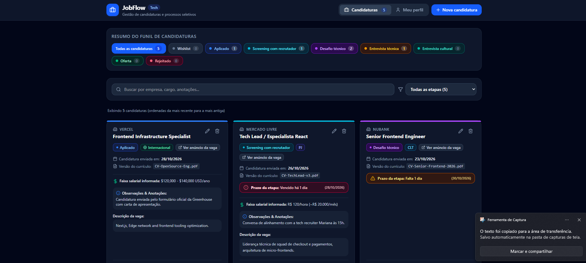
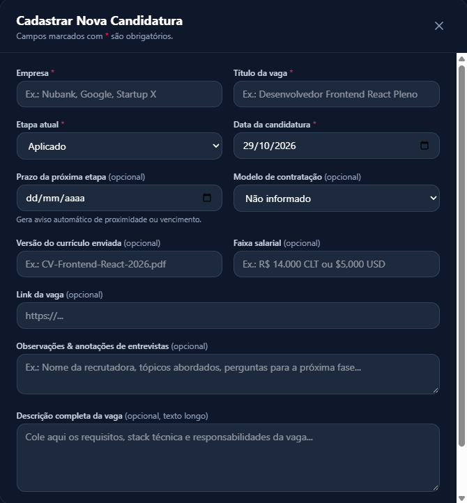
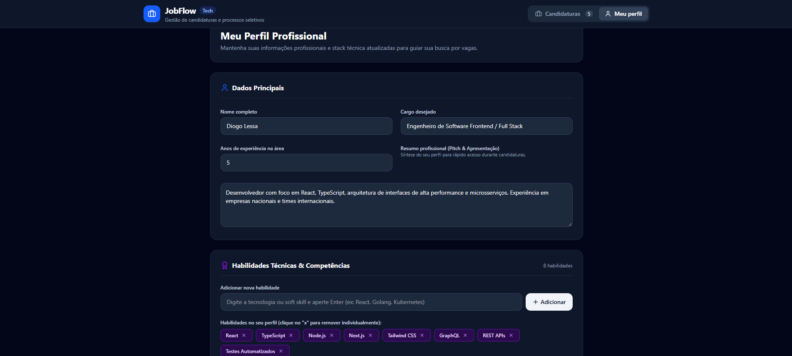

# JobFlow

JobFlow é uma plataforma completa para organizar e potencializar candidaturas a vagas de tecnologia. O projeto integra uma aplicação web para gestão visual do funil de processos seletivos a um agente de inteligência artificial autônomo (baseado no Google ADK) que analisa a aderência técnica do perfil do candidato aos requisitos de cada vaga de forma honesta e fundamentada.

---

## 🏗️ Estrutura do Repositório

O projeto é dividido em frentes modulares e complementares:

```text
jobflow/
├── src/                          # Aplicação Web Frontend (React + TypeScript)
│   ├── components/               # Componentes visuais (lista, formulários, cards, perfil)
│   ├── services/                 # Persistência local (storageService)
│   ├── types/                    # Tipos e modelos de dados (Candidatura, Perfil, Etapas)
│   └── utils/                    # Funções utilitárias e estilos por etapa
├── skills/                       # Especificação de Skills do Google ADK
│   └── analise-vaga/             # Skill de análise comparativa (SKILL.md, references, assets)
├── agente-jobflow/               # Agente Inteligente (Python + Google ADK)
│   ├── app/                      # Código modular do agente
│   │   ├── config.py             # Configurações de modelo, caminhos e diretórios
│   │   ├── prompt.py             # Instruction provider dinâmico (injeção da data atual)
│   │   ├── tools.py              # Ferramentas seguras de arquivo e carregamento de skill
│   │   ├── agent.py              # Composição do root_agent e app ADK
│   │   └── skills/analise-vaga/  # Cópia sincronizada da skill para execução do ADK
│   ├── analises/                 # Diretório de persistência de análises em JSON (ignorado no Git)
│   ├── tests/unit/               # Testes automatizados determinísticos com pytest
│   ├── .env.example              # Modelo de configuração de variáveis de ambiente
│   └── pyproject.toml            # Dependências Python gerenciadas via uv
├── AGENTS.md                     # Diretrizes e restrições de arquitetura do agente
└── COMMIT_GUIDELINES.md          # Padrões de commit semântico do repositório
```

---

## 💻 1. Aplicação Web (`src/`)

Interface moderna construída para substituir planilhas manuais e centralizar todas as etapas do processo seletivo em um só lugar.

### Principais Funcionalidades
- **Gestão de Candidaturas:** Criação, edição, exclusão e busca de oportunidades.
- **Funil de Processos Seletivos:** Acompanhamento por etapas padronizadas (*Wishlist, Aplicado, Screening com recrutador, Desafio técnico, Entrevista técnica, Entrevista cultural, Oferta, Rejeitado*).
- **Alertas de Prazo:** Indicadores visuais inteligentes (status neutro, atenção para prazos em até 3 dias e alerta para prazos vencidos).
- **Perfil Profissional:** Armazenamento centralizado de cargo pretendido, resumo profissional, habilidades técnicas e anos de experiência.
- **Persistência Local:** Salvamento instantâneo no navegador através de `localStorage` com dados de demonstração no primeiro uso.

### 📸 Visão Geral da Interface

#### Painel Principal e Funil de Candidaturas
Visão consolidada com métricas de cada etapa, busca rápida, filtros e cards detalhados com indicadores de prazo e histórico:


#### Cadastro Detalhado de Vagas
Formulário com suporte a modelo de contratação (CLT, PJ, Internacional), controle de versões de currículo, anotações de entrevistas e descrição completa:
<p align="center">
  
</p>

#### Perfil Profissional e Gestão de Habilidades
Configuração do perfil do candidato, incluindo cargo almejado, pitch de apresentação e gerenciamento de competências técnicas que alimentam o agente inteligente:


### Tecnologias do Frontend
- **React 19** + **TypeScript**
- **Vite** (build tool)
- **Tailwind CSS** (estilização utilitária)
- **Lucide Icons** & **Motion** (ícones e animações fluidas)

### Como executar o Frontend

```bash
# Na raiz do repositório:
npm install
npm run dev
```
Acesse a aplicação no navegador em `http://localhost:5173`.

---

## 🤖 2. Agente de Análise de Vagas (`agente-jobflow/`)

Agente autônomo baseado no **Google ADK** (Agent Development Kit) que avalia a aderência técnica entre vagas e perfis profissionais com foco em transparência e honestidade.

### Funcionalidades do Agente
- **Skill com Divulgação Progressiva (`analise-vaga`):**
  - **L1:** Metadados e gating no `SKILL.md`.
  - **L2:** Regra de ativação antes do carregamento de instruções profundas.
  - **L3:** Workflow de análise, esquema de saída e regras de persistência sob demanda.
- **Regra de Gating:** Exige a presença de empresa, cargo, descrição da vaga e habilidades antes de iniciar a análise. Se faltar algo, solicita apenas os dados faltantes sem desperdiçar contexto.
- **Honestidade Técnica (Sem Alucinação):** Requisitos da vaga ausentes no perfil são classificados estritamente como `lacuna`, nunca como atendidos. Requisitos correlatos são classificados como `parcial` com justificativa objetiva.
- **Priorização por Etapa:** Recomendações e planos de ação direcionados especificamente para a fase atual do candidato no processo seletivo.
- **Persistência e Histórico:** Grava e lê relatórios estruturados em JSON compatíveis com o esquema do JobFlow usando `WriteFile` e `ReadFile` dentro da pasta segura `analises/`.
- **Reanálise Comparativa:** Ao receber atualizações de perfil ou de etapa, compara a situação atual com a análise anterior e aponta a evolução da aderência.

### Arquitetura do Agente
O agente adota o princípio de Separação de Responsabilidades (SoC):
- [`app/config.py`](agente-jobflow/app/config.py): Leitura de variáveis (`MODEL`), diretórios absolutos e criação automática de `analises/`.
- [`app/prompt.py`](agente-jobflow/app/prompt.py): Injeção dinâmica da data atual (`YYYY-MM-DD`) no prompt do sistema via *instruction provider*.
- [`app/tools.py`](agente-jobflow/app/tools.py): Carregamento da skill via `SkillToolset` e subclasse `FerramentasDeArquivo(EnvironmentToolset)` expondo exclusivamente `ReadFile` e `WriteFile` (sem acesso a shell).
- [`app/agent.py`](agente-jobflow/app/agent.py): Ponto de entrada que instancia o `root_agent` e o objeto `app` para o servidor ADK Web.

### Pré-requisitos
- **Python 3.12+**
- **uv** (gerenciador de dependências e ambientes Python):
  ```bash
  curl -LsSf https://astral.sh/uv/install.sh | sh
  ```

### Configuração de Ambiente

1. Entre no diretório do agente:
   ```bash
   cd agente-jobflow
   ```

2. Crie o arquivo `.env` a partir do exemplo:
   ```bash
   cp .env.example .env
   ```

3. Configure sua chave da API do Google AI Studio no `.env`:
   ```env
   GOOGLE_GENAI_USE_VERTEXAI=FALSE
   GEMINI_API_KEY=sua-api-key-aqui
   MODEL=gemini-3.8-flash
   ```

4. Sincronize o ambiente virtual e dependências:
   ```bash
   uv sync
   ```

### Como executar o Agente (ADK Web)

Inicie o servidor de desenvolvimento do ADK:

```bash
cd agente-jobflow
uv run adk web --allow_origins="*"
```

- Acesse no navegador em `http://127.0.0.1:8000` (ou via **Web Preview** na porta 8000 no Google Cloud Shell).
- Selecione o agente **`app`** para conversar interativamente.

---

## 🧪 Testes Automatizados

O agente conta com uma suíte de testes unitários determinísticos (sem chamadas externas ou custos de LLM) que validam o isolamento de ferramentas, a injeção da data atual, a carga da skill e a integridade de diretórios:

```bash
cd agente-jobflow
uv run pytest
```

---

## 📋 Roteiro de Validação Interativa

Ao testar o agente no ADK Web, valide os 4 cenários essenciais:

1. **Gating (Regra de ativação):**
   - Envie: `"Quero analisar uma vaga de engenharia de dados."`
   - *Comportamento esperado:* O agente solicita apenas as informações que faltam (empresa/vaga, descrição e perfil), sem carregar recursos L3.
2. **Análise Completa:**
   - Envie os dados completos da vaga e do perfil.
   - *Comportamento esperado:* O agente processa a aderência, exibe as seções no formato do template e grava o arquivo JSON em `agente-jobflow/analises/`.
3. **Honestidade de Requisitos:**
   - *Comportamento esperado:* Requisitos não comprovados no perfil aparecem como `❌ Lacuna`.
4. **Reanálise / Mudança de Etapa:**
   - Envie: `"Atualizei meu perfil com a ferramenta X e mudei para a etapa de Entrevista técnica."`
   - *Comportamento esperado:* O agente lê o arquivo anterior com `ReadFile`, compara as diferenças e sobrescreve o JSON mantendo o histórico consistente.

---

## 🔒 Segurança de Dados

- **Credenciais:** Chaves de API e arquivos de ambiente (`.env`) são estritamente excluídos do controle de versão.
- **Dados Pessoais e Análises:** O diretório [`agente-jobflow/analises/`](agente-jobflow/analises/) armazena relatórios localmente e possui regra de exclusão explícita para evitar o commit acidental de dados de vagas ou perfis.
- **Superfície de Execução Mínima:** O agente não possui ferramentas de terminal ou shell, limitando-se apenas a operações controladas de leitura e gravação no diretório de análises.

---

## 👤 Autor

**Diogo Blessa**  
[GitHub](https://github.com/diogorblessa) · [LinkedIn](https://linkedin.com/in/diogorblessa)
